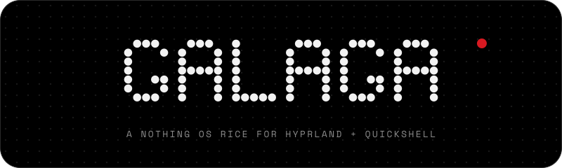

<div align="center">



Black, white dots, one red. A sibling of [Demon's Shot](https://github.com/Nebelung-cloud/demons-shot-rice).

My fork of [**glyph-rice**](https://github.com/Nebelung-cloud/glyph-rice) by [**Nebelung-cloud**](https://github.com/Nebelung-cloud) — the rice is his work, this copy just carries my own tweaks (see [Credits](#credits)).

<br>


</div>

<div align="center"></div>

<h2 align="center">What's inside</h2>

| | | |
|---|---|:---:|
| **Bar** | launcher, workspaces, clock, tray | |
| **Home** | clock, greeting, widgets (cava as a round Glyph Matrix), dot grid | |
| **Glyph** | screen edges as OSD: volume, brightness, notifications, progress | |
| **Launcher** | apps, commands, windows, calculator | `Super` |
| **Quick** | quick settings, game mode, media, notifications; also opens from the right edge | `Super` `A` |
| **Deck** | dashboard from the bottom edge | `Super` `Space` |
| **Prefs** | settings, bar and home layout | `Super` `I` |
| **Shot** | screenshots, editor, recording | `Print` |
| **Clip** | clipboard history | `Super` `V` |
| **Charms** | emoji, kaomoji, symbols | `Super` `.` |
| **Walls** | wallpapers as dots | `Super` `Shift` `W` |
| **VPN** | Clash Verge panel | `Super` `P` |
| **Cal** | calendar, focus timer | click the clock |
| **Buds** | Nothing / CMF earbuds: battery, ANC | |
| **Power** | power menu | `Super` `Esc` |
| **Lock** | lock screen | `Super` `L` |
| **Greeter** | boot login: the lock's face on greetd | `install.sh --greeter` |
| **Rice** | shell switcher, if Demon's Shot is installed too | `rice switch <name>` |

Also: Hyprland (Lua), hypridle, kitty, fish, starship, fastfetch, btop, cava (dots in fish; `command cava` for bars), GTK, Qt and folder colours.

<div align="center"></div>

<h2 align="center">Screenshots</h2>

| | |
|:---:|:---:|
|  **Launcher** |  **Quick** |
|  **Deck** |  **Prefs** |
|  **Shot** |  **Clip** |
|  **Power** | |

<div align="center"></div>

<h2 align="center">Install</h2>

```sh
git clone https://github.com/yasakei/glyph-rice ~/.local/share/glyph
~/.local/share/glyph/install.sh                  # Arch: packages, services, symlinks
~/.local/share/glyph/install.sh --with telegram  # same, extras picked up front
~/.local/share/glyph/install.sh --links          # any distro: symlinks only
~/.local/share/glyph/install.sh --greeter        # optional, Arch: boot login screen (replaces sddm)
```

Without `--with` it asks which extras to add: `telegram` (`Super` `D`), `spotify` with Spicetify (`Super` `M`),
`clash` for the VPN panel. Old configs go to `~/.dots-backup-<date>/`. Wallpapers are read from `~/Pictures/Wallpapers`.

| `config/` | goes to |
|---|---|
| `hypr/` | `~/.config/hypr` |
| `quickshell/glyph/` | `~/.config/quickshell/glyph` |
| `quickshell/rice/` | `~/.config/quickshell/rice`, `~/.local/bin/rice` |
| `quickshell/glyph/term/` | `starship.toml` `fastfetch/` `btop/` `cava/` `gtk-*/gtk.css` `qtengine.colors` in `~/.config` |
| `kitty/` `qtengine/` | `~/.config/…` |
| `fish/` | `~/.config/fish` |
| `fonts/` | `~/.local/share/fonts/glyph` |

Monitor, backlight, GPU and sensors are detected. Keyboard layouts are in `hypr/hyprland/input.lua`,
default apps in `hypr/variables.lua`. Earbuds photo: `quickshell/glyph/buds/<device-name>.png`.
Your own binds and overrides go in `hypr/user.lua`: it's gitignored, so `git pull` never touches it.
Apps for the special workspaces and the editor are read when you press the key, so `user.lua` can swap them:

```lua
local apps = require("variables").apps
apps.editor = "codium"              -- Super Shift K, empty by default
apps.todo   = "planify"             -- Super R, empty by default
apps.music  = "spicetify watch -s"  -- Super M, spotify-launcher by default

hl.bind("SUPER + G", hl.dsp.global("shell:game"))  -- game mode has no key by default
```

<div align="center"></div>

<h2 align="center">Window buttons</h2>

Every window gets the same three buttons, top-left, in the same order: **close** (red),
**minimise** (white), **maximise** (black) — one look, two layers (GTK headerbar apps
are the exception: they render close and maximise — minimise is the one button that
cannot be made real there, for the reasons under "Minimise is not real"):

- **Server-side windows** (terminals, most apps) get a bar from **hyprbars**, the
  hyprland-plugins plugin — `install.sh` adds and enables it through hyprpm, the config is
  `hypr/hyprland/titlebars.lua`. The window's title sits centred in the bar in **Doto**,
  the dot-matrix font from `config/fonts`, bold. The buttons run the same dispatchers as
  the keybinds, so a click animates exactly like the keyboard: close rides `windowsOut`,
  maximise and the minimise move ride `windowsMove` (`hypr/hyprland/animations.lua` — the
  animation tree has no fullscreen leaf, geometry changes are `windowsMove`). The black
  button **maximises** — the window fills the workspace and the bar and gaps stay;
  double-clicking the bar toggles **true fullscreen**. The glyphs are mac-style: the discs
  sit plain and all three glyphs appear only while the cursor hovers one of the buttons
  (hyprbars' `icon_on_hover`; on the GTK side the same reveal is done in CSS).
- **Apps that draw their own buttons** (GTK headerbar apps, Electron) are excluded
  from the bar in `hypr/hyprland/rules.lua` (`hyprbars:no_bar`) and themed instead:
  `quickshell/glyph/term/gtk-3.0` and `gtk-4.0` ship a `settings.ini` and CSS that paints
  the native **close** and **maximise** buttons as the same red and black discs, with
  their glyphs from `term/window-buttons/`. Close and maximise are rendered
  (`gtk-decoration-layout=close,maximize:appmenu`) — and maximise genuinely works:
  the click sends a maximise request, and `rules.lua` exempts exactly these apps from
  its global maximise suppression, so Hyprland honours it (for every other app the
  suppression stays: the tiling layout decides sizes, apps do not maximise
  themselves). Minimise is not rendered: its request can never land — see
  "Minimise is not real" below — so it is not shown at all, rather than painted as a
  disc whose click does nothing. The exclusions are one curated list in `rules.lua`
  (the `ownButtons` list at the top of the file): there is no protocol signal for
  "this app draws its own buttons", so the list is the mechanism. If some app shows
  **both** bars, add it — focus the window, read its class with `hyprctl activewindow`
  (or find it in `hyprctl clients`), add one line to the list: the hyprbar goes away
  and the app's own maximise starts working. GTK4 needs its own
  rules in that CSS: there the button itself is transparent and the visible disc is its
  image node, so colours and glyphs are painted on `windowcontrols button > image` —
  painting the button (the GTK3 way) leaves GTK4 buttons plain grey. **Flatpak** GTK apps
  are sandboxed off from `~/.config/gtk-*` entirely, so `install.sh` also grants the
  installed GNOME flatpaks (Calculator, Nautilus, Text Editor, …) read-only access to the
  two gtk config dirs via `flatpak override --user`; by hand it is
  `flatpak override --user org.gnome.Calculator --filesystem=xdg-config/gtk-3.0:ro --filesystem=xdg-config/gtk-4.0:ro`,
  then restart the app.
- **Browsers** split in two. **Firefox and Zen** are own-buttons apps, on the same
  `rules.lua` list as the GTK apps: they keep their built-in buttons and get no
  hyprbar. Their button box follows the decoration layout this rice ships for GTK
  (`close,maximize` — no minimise, whose click could not work here), so what they
  draw is exactly the buttons that work: close, and a maximise the suppression
  exemption lets land. Minimise is `Super+Alt+M`, like every own-buttons app.
  (Earlier versions tried the opposite — a `user.js` in every profile switching
  the built-ins off so the hyprbar could take over; the pref kept not reaching
  the profiles that mattered, the Flatpak's above all. `install.sh` now removes
  that snippet from every profile it was ever deployed to — it has to: a profile
  that kept it would draw no buttons of its own *and* get no hyprbar.) For
  **Chromium, Chrome and Brave** nothing changes: there is no file to deploy —
  turn on **Use system title bar and borders** once (Settings → Appearance) and
  they draw no buttons of their own, so the hyprbar takes over there.

**Minimise is not real.** Hyprland has no minimise: the white button (and `Super+Alt+M`)
parks the window on the hidden `special:minimized` workspace. `Super+Alt+Shift+M` peeks at
that workspace — focus a window there and pull it back with any move-to-workspace bind
(`Ctrl+Super+Shift+↓` moves it to the current workspace).

That is also why GTK apps' headerbars show **no minimise disc**. Their own − / ▢
buttons send xdg requests into the compositor, and the two requests have different
fates. **Maximise can land** — it is a real state in Hyprland — and does: the
config's global maximise suppression (`suppress_event = "maximize"` in `rules.lua`,
kept for everything else because the tiling layout decides window sizes) is scoped
to exempt exactly the own-buttons apps, so their ▢ renders as the black disc and
maximises / unmaximises on click. **Minimise cannot land**: the request is received
and dropped — Hyprland has no minimised state to put a window in, and doesn't even
advertise the minimise capability to clients. And nothing outside the compositor
can catch the click on its way down: no IPC event fires for a window's *own*
minimise request (the event socket's `minimized` event only reports an *external*,
taskbar-style client asking to minimise a window), and the plugin API's hooks
mirror those same events, so the point where the request dies is unreachable from
outside. Reaching it would take a custom C++ plugin hooking Hyprland's internal
xdg state handling — and a plugin is built against one Hyprland version's headers
and refuses to load on any other, so it would break on every Hyprland upgrade.
That trade is deliberately not shipped; the keyboard route below is the minimise
story for these apps. There is also no supported way to move those apps onto the
hyprbar instead —
GTK4 ignores `GTK_CSD` on Wayland, libadwaita's headerbar *is* app content (Calculator's
mode switcher and undo/redo live there), and Hyprland has no rule to force a client
into server-side decorations — so the headerbar stays, its working buttons render,
and for GTK apps minimise lives on the keyboard, firing the same dispatchers as the
bar buttons: `Super+Alt+M` parks, `Super+Alt+F` maximises, `Super+F` fullscreens.

Parked windows are listed in the **deck** (bottom edge): a fixed **minimised** section at
its right end, behind a thin line, shows each parked window's icon and name — click one
and it moves back to the current workspace, focused. The list is live (it reads the
Hyprland window model directly), scrolls when full, and reads "nothing minimised" in
dots when empty.

Exceptions and notes:

- Fullscreen windows, picture-in-picture and XWayland popups get no bar.
- **Telegram** draws its own headerbar under the bar (its settings live in a binary
  store — there is no config file to flip). Turn on **Use system window frame** once
  (Settings → Advanced, under System integration on some versions) and restart it:
  its own controls disappear and only the bar remains.
- **VS Code** draws its own titlebar and ignores both layers. Its buttons stay its own —
  or set `"window.titleBarStyle": "native"` and remove `Code` from the own-buttons
  list in `rules.lua`, then the bar above takes over.
- **Qt apps** need nothing: qtengine/Darkly style widgets, not decorations (no Qt setting
  carries a button layout — nothing to fake), and their windows are server-side here, so
  hyprbars draws their buttons.
- **hyprpm is its own package** now (it used to ship inside `hyprland`). `install.sh`
  installs it when missing and prints a loud warning if it still cannot be found —
  without it the plugin step is skipped and the bars never appear. Note `--links` does
  not run the plugin step: after a fresh clone, run the full install once (or the hyprpm
  commands by hand), not just `--links`.
- **After a Hyprland upgrade** the plugin is built against the old version and quietly
  stops loading: `hyprpm update`, then `hyprpm reload` or relog.
- No bar on a GTK app is normal — it has its own buttons. A bar *and* native buttons on the
  same window means the app is missing from the own-buttons list: find its class with
  `hyprctl activewindow` (or `hyprctl clients`) and add one line to `ownButtons` in
  `rules.lua` — the bar goes away and the app's own maximise starts working.

<div align="center"></div>

<h2 align="center">Login screen (greeter)</h2>

The lock screen, at boot. The rice's session lock only exists inside a session, so the
default install still boots into sddm's plain card. The optional greeter step replaces it
with **the same face**: same dot clock, dotted avatar, password pill, same dots — one
drawing (`lock/LockFace.qml`) with its PAM backend swapped for
[ greetd ](https://git.sr.ht/~kennylevinsen/greetd) via Quickshell's Greetd service
(`greet.qml`).

```sh
~/.local/share/glyph/install.sh --greeter   # Arch only; separate on purpose, not in the default run
```

What it does, in order: installs `greetd`; copies the shell config to `/etc/greetd/glyph`
(the greeter runs as the `greeter` user and cannot read `~/.config` — re-run `--greeter`
after a pull to refresh the copy); installs the fonts system-wide in
`/usr/share/fonts/glyph` (same reason — without them the Doto clock is not Doto); writes
`/etc/greetd/config.toml`, `hyprland.lua` and `glyph-greeter` (a changed file that already
exists is backed up to `~/.dots-backup-<date>/etc/greetd/` first); and only then swaps the
display manager — the currently enabled one (sddm, gdm, …) is disabled and its name
recorded in `~/.dots-backup-<date>/previous-display-manager.txt`, greetd is enabled. If
anything fails before the swap, the old login is untouched. Re-running changes nothing
twice.

The greeter session is a **stripped Hyprland** (`config/greetd/hyprland.lua`): no plugins,
no binds, no daemons — it starts the face and exits when the face does, which is what lets
greetd hand over to your session. It is launched through `start-hyprland -- --config …`
(Hyprland's watchdog wrapper; Hyprland's own arguments go after the `--`): launching the
raw `Hyprland` binary instead makes Hyprland paint a *"started without start-hyprland"*
warning banner across the greeter screen. The wrapper does not change the hand-over — it
stays in front until Hyprland exits and exits with it on a clean exit, which is exactly
the login path. Its input section mirrors the session's, NumLock
included: `numlock_by_default` is on, so a numpad PIN types from a cold boot without
touching NumLock. Keyboard focus is held from the first frame — just start typing; keys
combined with Ctrl/Alt/Super are ignored (they are shortcuts, not password characters).

- **User switching:** the name sits in a bubble with a caret. Click it and every other
  human user on the machine (uid ≥ 1000, real shell) is listed; picking one cancels the
  in-flight auth, clears the field and starts auth for that user. Faces come from
  AccountsService (`/var/lib/AccountsService/icons/<user>`) or `~/.face`, else the dotted
  gradient. The last picked user is remembered and pre-selected next boot.
- **Session:** exactly the one you already run — the `Hyprland (uwsm-managed)` entry,
  resolved at runtime from `/usr/share/wayland-sessions/*.desktop` (fallback: the first
  Hyprland entry, then the first entry there is). There is deliberately no session picker
  on the face.
- **Honest notes:** greetd *replaces* your display manager — that is the whole point, and
  the step is separate and explicit for that reason. Weather and the player line come from
  session services; with no session yet they simply stay empty, as the lock's fallbacks
  already allow. The layout chip reads `en` until login (the stripped compositor's layout
  is the one in `hyprland.lua` — keep its `kb_layout` in step with the session's).

Rollback, as printed by the step itself:

```sh
sudo systemctl disable greetd && sudo systemctl enable sddm   # or whichever DM was recorded
```

And if the greeter ever fails to appear: Hyprland keeps VT switching alive, so
`Ctrl+Alt+F3` → log in on the text console → run the rollback → reboot.

<div align="center"></div>

<h2 align="center">Dependencies</h2>

| | |
|---|---|
| **Shell** | `quickshell` (Qt 6.9+) · `hyprland` 0.56+ · `hypridle` · `hyprsunset` · `xdg-desktop-portal-hyprland` · `jq` · `curl` · `python3` · `libqalculate` |
| **System** | `networkmanager` · `bluez` · `pipewire` · `pipewire-pulse` · `pipewire-alsa` · `wireplumber` · `upower` · `power-profiles-daemon` · `brightnessctl` · `libnotify` · `playerctl` · `polkit-gnome` · `gnome-keyring` · `geoclue` |
| **Capture** | `grim` · `slurp` · `imagemagick` · `libvips` · `gpu-screen-recorder` · `cliphist` · `wl-clipboard` |
| **Terminal** | `kitty` · `fish` · `starship` · `fastfetch` · `btop` · `cava` · `eza` · `zoxide` · `direnv` |
| **Look** | `papirus-icon-theme` · `adw-gtk-theme` · JetBrains Mono Nerd Font · `noto-fonts-emoji` (Emoji 17) · `noto-fonts-cjk` · Bibata · `qtengine` · `darkly` |
| **Optional** | `clash-verge-rev` · `nvidia-utils` · `ydotool` · `hyprpicker` · `swappy` · `trash-cli` |

From the AUR only `qtengine`, `darkly`, Bibata and Zen, plus Spicetify and Clash Verge if picked; all optional. The VPN panel expects Clash Verge in English.
NixOS: change the `/usr/lib` agent paths in `hypr/hyprland/execs.lua` and the Papirus path in `quickshell/rice/rice`.

<div align="center"></div>

<h2 align="center">Colours</h2>

<div align="center"></div>

<br>

Dark and light. Red marks the one live thing on screen.
Fonts: Doto, Space Grotesk, Space Mono, JetBrains Mono Nerd Font.

<div align="center"></div>

<h2 align="center">Inspiration</h2>

- [**Nothing OS**](https://nothing.tech): the look and the Glyph lights.
- [**Doto**](https://github.com/oliverlalan/Doto): the dot matrix font.
- [**Gadgetbridge**](https://codeberg.org/Freeyourgadget/Gadgetbridge): the earbuds protocol in `glyph/ear`.
- [**Caelestia**](https://github.com/caelestia-dots/shell): the shell I used before; the deck and hardware detection follow it.

<div align="center"></div>

<h2 align="center">Credits</h2>

**Glyph** is made by [**Nebelung-cloud**](https://github.com/Nebelung-cloud): [glyph-rice](https://github.com/Nebelung-cloud/glyph-rice)
and its sibling [Demon's Shot](https://github.com/Nebelung-cloud/demons-shot-rice). The shell, the launcher, the theme — all of it is his.
This repository is my personal fork, kept under the same GPL-3.0 license; upstream is the place to look for the project itself.

What my fork changes on top of upstream:

- launcher: tap `Super` opens it again on Hyprland 0.57, where binds on the modifier key itself stopped firing —
  the release is detected by polling the key state instead of `bindr` (`hypr/hyprland/keybinds.lua`)
- gestures: workspace swipe horizontal, 4 fingers; 3 fingers for the special workspace
- keys: `Super` `Q` closes a window, `Super` `T` opens the terminal

<div align="center"></div>

<h2 align="center">License</h2>

[GPL-3.0](LICENSE). Fonts are under the [OFL](config/fonts/OFL.txt), cava shaders keep their MIT headers.
Nothing, Nothing OS and Glyph are trademarks of Nothing Technology Ltd; this is a fan project, not affiliated with Nothing.

<div align="center"></div>

<div align="center">

```
ᓚᘏᗢ  · · ·
```

```
⠀⠀⠀⠀⣰⣶⣦⣄⡀⠀⠀⠀⠀⠀⠀⠀⠀⠀⠀⠀⠀⠀⠀⢀⣤⣶⣶⡆⠀⠀⠀⠀
⠀⠀⠀⢠⣿⣿⣿⣿⣿⣦⡀⠀⠀⠀⠀⠀⠀⠀⠀⠀⠀⣠⣶⣿⣿⣿⣿⣿⠀⠀⠀⠀
⠀⠀⠀⢸⣿⣿⣿⣿⣿⣿⣿⣦⡀⠀⠀⠀⠀⠀⠀⢀⣾⣿⣿⣿⣿⣿⣿⣿⡆⠀⠀⠀
⠀⠀⠀⢸⣿⣿⣿⣿⣿⣿⣿⣿⣿⣄⣀⣀⣀⣀⣰⣿⣿⣿⣿⣿⣿⣿⣿⣿⡇⠀⠀⠀
⠀⠀⠀⢸⣿⣿⣿⣿⣿⣿⣿⣿⣿⣿⣿⣿⣿⣿⣿⣿⣿⣿⣿⣿⣿⣿⣿⣿⡇⠀⠀⠀
⠀⠀⠀⠸⣿⣿⣿⣿⣿⣿⣿⣿⣿⣿⣿⣿⣿⣿⣿⣿⣿⣿⣿⣿⣿⣿⣿⣿⠁⠀⠀⠀
⠀⠀⠀⠀⢿⣿⣿⣿⣿⣿⡿⢿⣿⣿⣿⣿⣿⣿⣿⣿⠿⣿⣿⣿⣿⣿⣿⡏⠀⠀⠀⠀
⠀⠀⠀⠀⣼⣿⣿⣿⣿⡏⠀⠀⢹⣿⣿⣿⣿⣿⣿⠃⠀⠀⣿⣿⣿⣿⣿⣆⠀⠀⠀⠀
⠀⠀⠀⣸⣿⣿⣿⣿⣿⣷⣀⣀⣼⣿⣿⣿⣿⣿⣿⣦⣀⣠⣿⣿⣿⣿⣿⣿⡆⠀⠀⠀
⣀⣠⣤⣿⣿⣿⣿⣿⣿⣿⣿⣿⣿⣿⣿⣿⣿⣿⣿⣿⣿⣿⣿⣿⣿⣿⣿⣿⣷⣤⣀⡀
⠻⠿⠛⣿⣿⣿⣿⣿⣿⣿⢿⣿⣿⣿⣷⠀⢀⣿⣿⣿⣿⣿⣿⣿⣿⣿⣿⣿⡟⠛⠿⠇
⠀⢀⣠⣾⣿⣿⣿⣿⣿⣿⡈⢿⣿⣿⣿⠃⠸⣿⣿⣿⡿⢰⣿⣿⣿⣿⣿⣿⣷⣄⠀⠀
⠀⢿⠿⠋⢻⣿⣿⣿⣿⣿⣷⣄⣉⣉⣡⣾⣧⣈⣉⣉⣴⣿⣿⣿⣿⣿⣿⠏⠙⢿⡗⠀
⠀⠀⠀⠀⠀⠻⣿⣿⣿⣿⣿⣿⣿⣿⣿⣿⣿⣿⣿⣿⣿⣿⣿⣿⣿⣿⠏⠀⠀⠀⠀⠀
⠀⠀⠀⠀⠀⠀⠈⠻⣿⣿⣿⣿⣿⣿⣿⣿⣿⣿⣿⣿⣿⣿⣿⡿⠟⠁⠀⠀⠀⠀⠀⠀
⠀⠀⠀⠀⠀⠀⠀⠀⠀⠉⠛⠻⠿⢿⣿⣿⣿⣿⠿⠿⠟⠛⠉⠀⠀⠀⠀⠀⠀⠀⠀⠀
```

</div>
